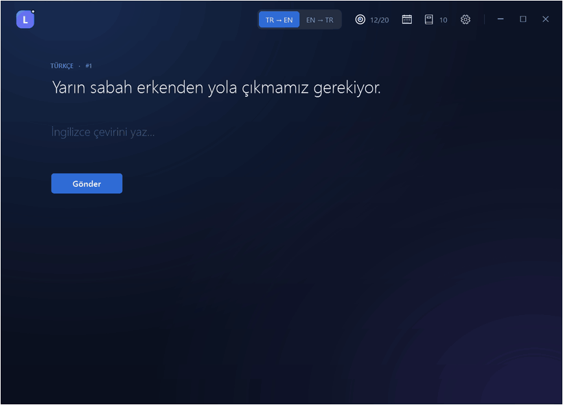
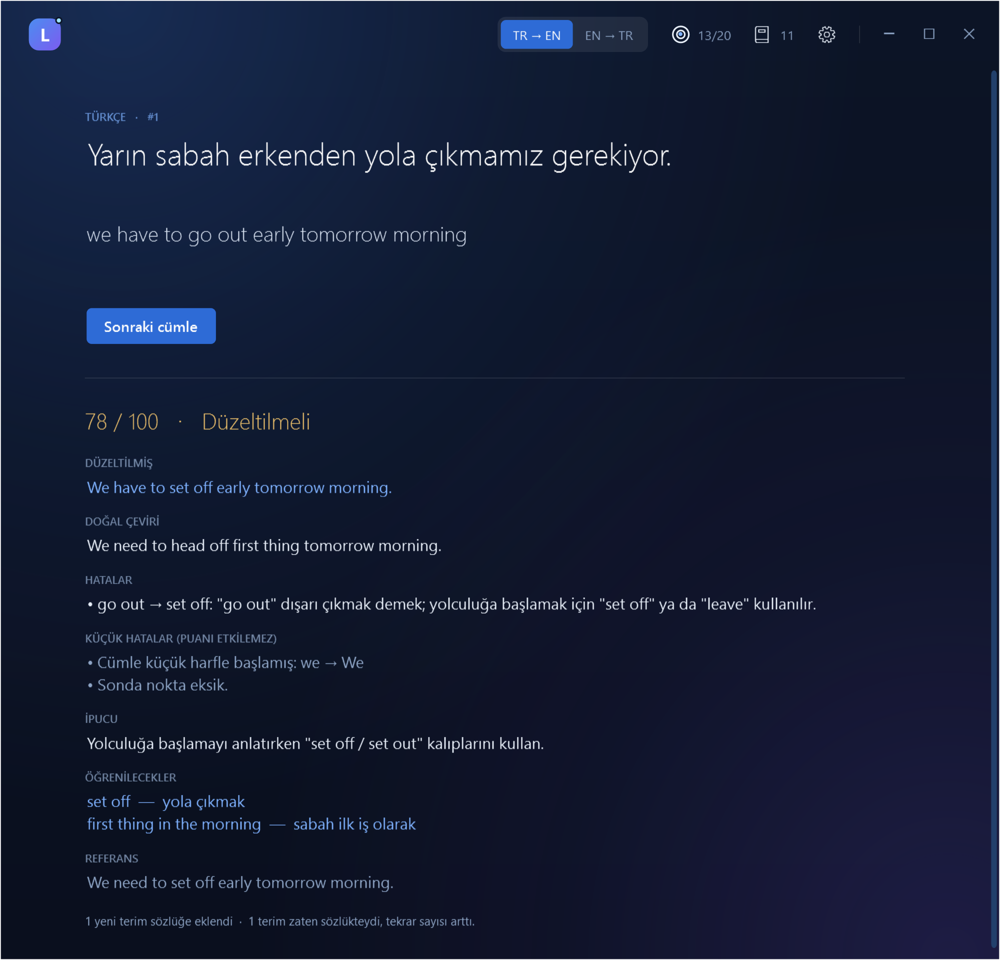
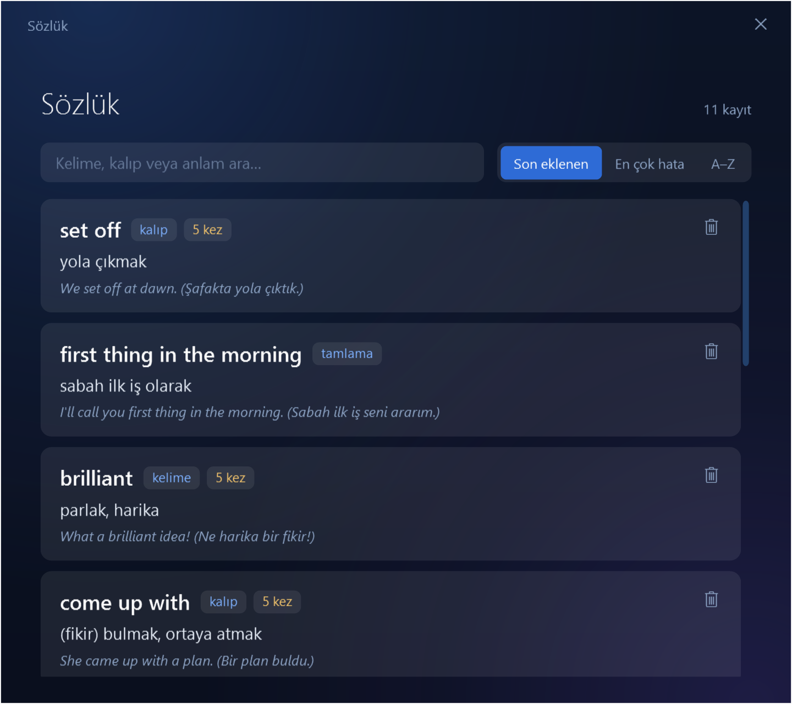
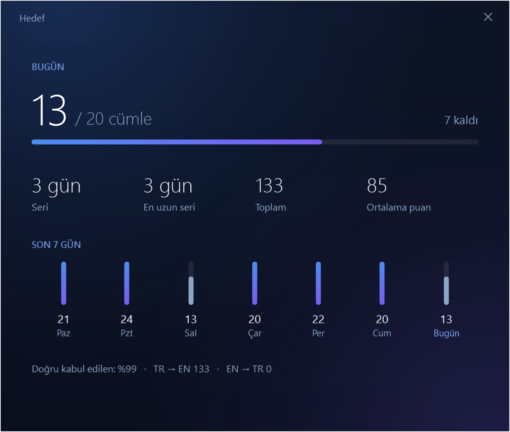
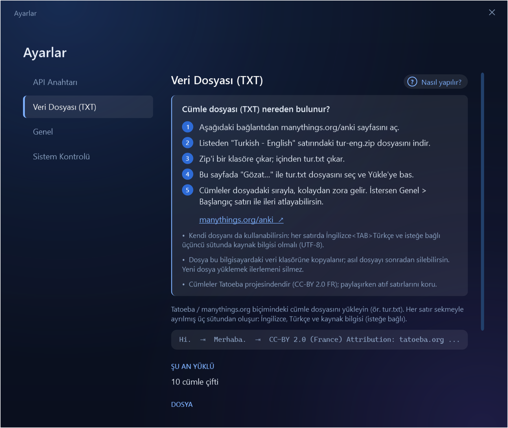

<div align="center">

# Lingora

**Cümle cümle çeviri yaparak İngilizce yazma ve okuma becerini geliştiren, yapay zekâ destekli Windows masaüstü uygulaması.**




</div>

---

## Neden Lingora?

Kelime ezberlemek yerine **gerçek cümleleri çevirerek** öğrenirsin. Lingora sana bir cümle gösterir,
sen çevirini yazarsın; Google Gemini çevirini bir öğretmen gibi değerlendirir:

- **Puan ve geri bildirim:** düzeltilmiş çeviri, daha doğal bir çeviri, hataların Türkçe açıklaması ve bir ipucu.
- **Adil puanlama:** yazım hatası ("gitmak" → "gitmek"), küçük harfle başlama, noktalama gibi
  **küçük hatalar puanı düşürmez**; ayrıca "küçük hatalar" olarak listelenir. Puanı anlam, dil bilgisi ve kelime seçimi belirler.
- **Kişisel sözlük:** eksik kaldığın kelime, kalıp ve tamlamalar anlamı ve örnek cümlesiyle otomatik
  kaydedilir. Aynı terimde tekrar hata yaparsan yeni kayıt açılmaz, "N kez" sayacı artar.
- **İki yön:** TR → EN yazmayı, EN → TR okumayı çalıştırır.
- **Kolaydan zora:** cümleler dosyadaki sırayla gelir; istersen istediğin satırdan başlarsın
  (ör. ilk 10.000 satırı atla). Kaldığın yer kaydedilir.
- **Günlük hedef ve seri:** bugün kaç cümle yaptığın, hedefe ulaşıp ulaşmadığın, seri ve son 7 gün.

## Ekranlar

| Değerlendirme | Sözlük |
|:---:|:---:|
|  |  |
| **Günlük hedef** | **Adım adım yardım** |
|  |  |

## Kurulum

Gereksinim: **Windows 10/11** ve [.NET 8 SDK](https://dotnet.microsoft.com/download/dotnet/8.0)
(yalnızca çalıştırmak için .NET 8 Desktop Runtime yeterli).

```powershell
git clone https://github.com/ulaer/lingora.git
cd lingora
dotnet publish src/Lingora.Desktop -c Release -r win-x64 --self-contained false -o uygulama
.\uygulama\Lingora.exe
```

### İlk açılış: anahtar ve cümle dosyası

> Depoda **API anahtarı veya cümle dosyası yoktur.** İkisini de sen eklersin; uygulama ilgili
> sayfalarda **"Nasıl yapılır?"** düğmesiyle adım adım anlatır (ilk açılışta bu yardım kendiliğinden açık gelir).

1. **Gemini API anahtarı** — Ayarlar (⚙) → **API Anahtarı**
   - [aistudio.google.com/apikey](https://aistudio.google.com/apikey) adresinden ücretsiz anahtar oluştur.
   - Yapıştır → **Kaydet** → **Bağlantıyı test et**.
   - Anahtar koda veya depoya girmez; bu bilgisayarda **Windows DPAPI** ile şifrelenip saklanır.
     İstersen `GEMINI_API_KEY` ortam değişkeni de kullanılabilir.

2. **Cümle dosyası (TXT)** — Ayarlar (⚙) → **Veri Dosyası (TXT)**
   - [manythings.org/anki](https://www.manythings.org/anki/) adresinden **Turkish – English** (`tur-eng.zip`) dosyasını indir, içindeki `tur.txt`'yi çıkar.
   - **Gözat…** ile seç → **Yükle**. Beklenen biçim (sekmeyle ayrılmış):

     ```
     İngilizce<TAB>Türkçe<TAB>Kaynak bilgisi (isteğe bağlı)
     ```

## Kullanım

| Öğe | İşlev |
|-----|-------|
| **TR → EN / EN → TR** | Çeviri yönü |
| **◎ 13/20** | Hedef penceresi: bugün, seri, toplam, ortalama puan, son 7 gün |
| **📖 11** | Sözlük: arama, sıralama (son eklenen / en çok hata / A–Z), silme |
| **⚙** | Ayarlar: API anahtarı, veri dosyası, günlük hedef, zorluk, sıra, başlangıç satırı, model, sistem kontrolü |

| Tuş | İşlev |
|-----|-------|
| `Enter` | Gönder / (cevap yazılıyorsa) hemen tamamla / sonraki cümle |
| `F5` | Cümleyi atla |
| `Esc` | Ek pencereyi kapat |

**Model:** varsayılan `gemini-flash-latest`. Hızlı ve ücretsiz kotası geniş bir seçenek için
Ayarlar → Genel'de `gemini-3.5-flash-lite` yazabilirsin. Hesabında açık olan modelleri
**Bağlantıyı test et** listeler.

## Gizlilik

- Veriler yalnızca bu bilgisayarda, `%APPDATA%\Lingora` klasöründe tutulur
  (`settings.json`, `corpus.tsv`, `attempts.jsonl`, `vocabulary.json`). Başka bir klasör için `LINGORA_HOME`.
- Gemini'ye yalnızca kaynak cümle, referans çeviri(ler) ve senin çevirin gönderilir.
  Anahtar URL'de değil `x-goog-api-key` başlığında gider; loglara yazılmaz.

## Mimari

```
src/Lingora.Core/       İş mantığı (arayüzden bağımsız, test edilen kısım)
  Corpus/               TXT içe aktarma (UTF-8 / Windows-1254), sıralı ve rastgele cümle seçimi
  Gemini/               İstem (prompt), yapılandırılmış JSON şeması, REST istemcisi, Türkçe hata mesajları
  Lexicon/              Kişisel sözlük ve benzer terim birleştirme
  Progress/             İlerleme kaydı (JSON Lines), seri ve günlük hedef hesapları
  Storage/              Ayarlar, DPAPI ile şifreli anahtar, veri klasörü
src/Lingora.Desktop/    WPF arayüzü: özel başlık çubuğu, tema, daktilo animasyonu
tests/Lingora.Tests/    xUnit: çekirdek + WPF arayüz testleri (pencere açmadan, ekran görüntüsüyle)
```

- **.NET 8 · WPF · xUnit**, harici arayüz kütüphanesi yok.
- Zaman `TimeProvider` ile enjekte edilir; testler sabit saatle çalışır.
- Arayüz testleri WPF'i tek bir STA iş parçacığında, ekrana pencere açmadan çalıştırır.

## Geliştirme

```powershell
dotnet build Lingora.sln
dotnet test Lingora.sln
dotnet run --project src/Lingora.Desktop
```

Arayüz testlerinin ekran görüntüleri için `LINGORA_SCREENSHOTS`, README görselleri ve demo için
`LINGORA_MEDIA` ortam değişkenini bir klasöre ayarla (ayrıntı: [docs/media/make-media.ps1](docs/media/make-media.ps1)).
Gereksinim takibi: [docs/GEREKSINIMLER.md](docs/GEREKSINIMLER.md).

## Telif ve atıf

- © 2026 Lingora. Tüm hakları saklıdır. Bu depo açık kaynak lisansı ile dağıtılmaz; kod yalnızca incelemek içindir.
- Cümle verisi bu depoda yoktur. Önerilen kaynak: [Tatoeba](https://tatoeba.org) (CC-BY 2.0 FR),
  [manythings.org](https://www.manythings.org/anki/) üzerinden. Dosyalardaki atıf satırlarını koru.
- Gemini, Google LLC'nin markasıdır. Lingora Google ile bağlantılı değildir.
